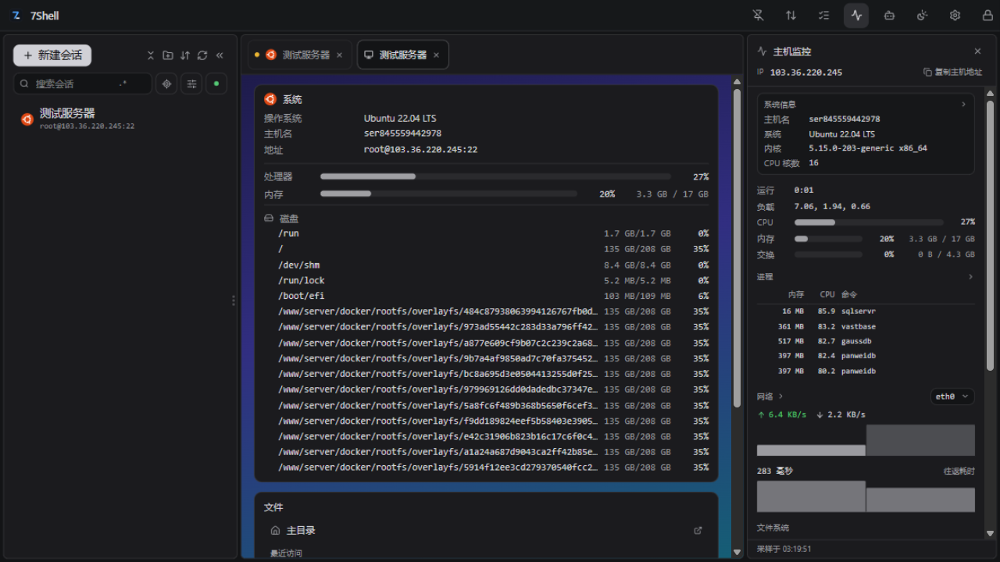
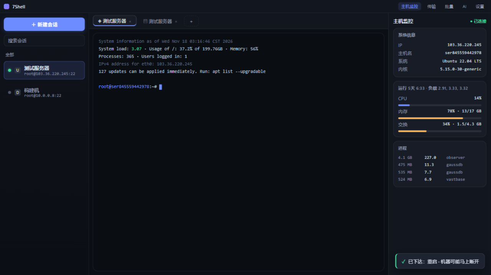
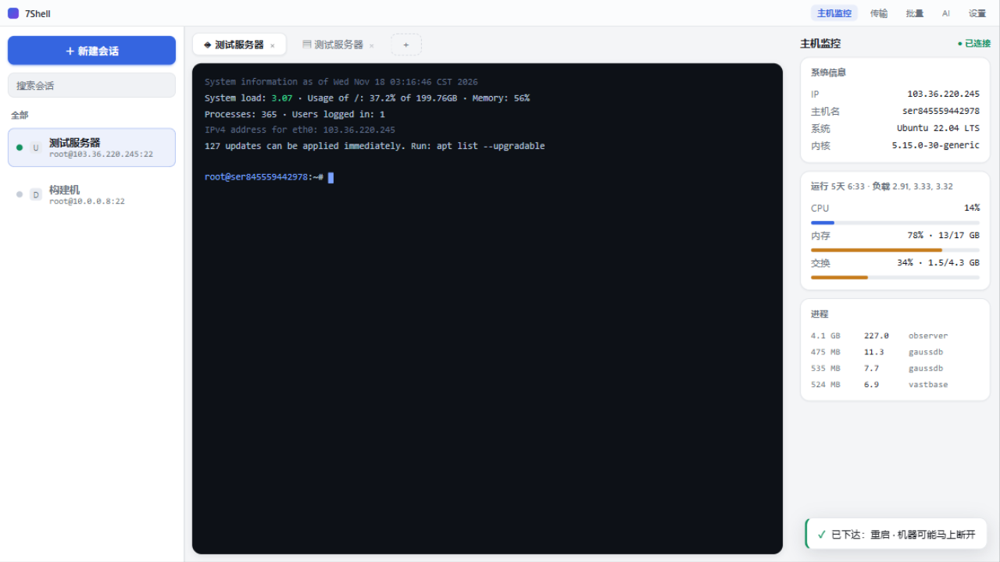
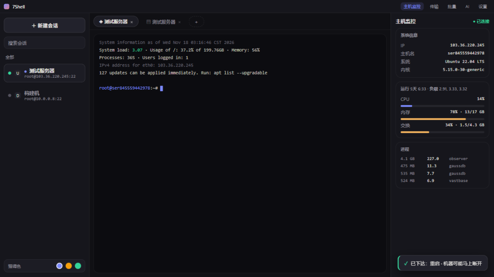

# 界面视觉优化（全界面重皮）开发计划

- 日期：2026-11-18（基线：song 分支 d1a9a51）
- 状态：待评审启动。技术路线已定（方案 A：现有 token 体系补四块 + elevation，见[调研报告](../调研报告/20261118-0754-界面视觉优化-调研报告.md)）；**视觉形态方向未定——P0 预览评审是全计划的第一闸门**。
- 决策依据：[界面视觉现状盘点-调研报告](../调研报告/20261118-0300-界面视觉现状盘点-调研报告.md)（实测证据）、外部参照与暗色 elevation 体系（调研报告第二节）。

## 〇、总闸门：形态预览评审（LESSONS I26，先于一切落码）

UI 品味是用户的主观决策，绿灯读数不构成方向依据。落码前必须：

1. 制作 **2~3 个候选形态**的对比预览稿（不进生产代码）：在同一张真机截图底稿上，用 token 手调/tweakcn 思路产出候选 A「精致暗色」（Termius 向：elevation 分层 + 品牌强调色 + 圆角面板）、候选 B「清晰亮色」（呼吸感 + 大字号锚点）、候选 C「混合」（暗色为主 + 可切强调色），每候选覆盖同一组界面（主工作区/文件浏览器/设置页）。
2. 用户点头选定方向后，把新的**字号层级、radius 档、elevation 取值、动效时长**写进 `docs/ui-conventions.md`（宪法修订，单独提交），同步改 `scripts/tests/typography.test.mjs` 等守卫——先改宪法再改代码，防止新样式被旧守卫反复打红。
3. 预览稿标注「设计稿，非实现截图」（文档命名规范第四节）。

### 预览稿归档（2026-11-18 制作，均为主工作区同一底稿，1280×720）

**现状基线**（真实截图）：

*设计稿对照用真机截图，非设计稿。*

**候选 A · 精致暗色**（Termius 向：蓝黑基底、elevation 分层卡片、克制蓝紫强调色、圆角面板）：

*设计稿，非实现截图。*

**候选 B · 清晰亮色**（白卡片灰画布、呼吸感与字号锚点、终端保持暗色作对比焦点）：

*设计稿，非实现截图。*

**候选 C · 混合暗色**（暖黑基底、药丸 tab、更大圆角、强调色可切换）：

*设计稿，非实现截图。*

> 2026-11-18 评审记录：用户过目后决定**暂不启动改造**，预览稿归档于此备用；方向决策延后。

## 一、目标与非目标

**目标**：全部界面视觉升级——字体、字号层级、基础件手感、动效、暗色纵深、空态/加载态、个性化外观域；覆盖桌面与浏览器双宿主、亮暗 × 13 调色板矩阵。

**非目标**：
- 不换组件库、不引入重量级 UI 框架（方案 B 仅在键盘导航复杂件按需引 reka-ui 单件，且须单独说明）；
- 不动 token 架构与 13 套调色板（它们是资产）；
- 不改信息架构/交互流程（布局重排只在预览评审显示必要时单独立项）；
- 不动终端 xterm 的配色链路（CSS 变量 → JS 读取 → xterm theme 原样保留，xterm 不吃 oklch 是已记录的坑）；
- 不碰 CSP（`style-src 'unsafe-inline'` 是 xterm 生命线，windowCsp 守卫钉死）。

## 二、五步落地（依赖顺序）

### P1 字体真实化（半天，杠杆最高）

- 自托管 Inter variable（woff2，OFL）+ JetBrains Mono（代码/机器文本），进 `apps/desktop/src/assets/fonts/`；字体栈补 CJK 回退（中文界面走系统雅黑/苹方，不打包中文字体）。
- THIRD_PARTY_NOTICES 补 OFL 条目；`@font-face` 放 globals.css，双宿主自动生效。
- 验收：DevTools 确认 Inter 真实加载（此前从未加载——字体栈首位是摆设）；截图对比；字体回退链在无网环境不抖。

### P2 基础件与动效（核心手术面，2~4 天）

- **Button 基础件**：`components/ui/AppButton.vue`（cva 变体 primary/secondary/ghost/destructive × sm/md，焦点环统一）——现状 431 个裸 button 零抽象、cva 装了没用。先收编高频 20 处，其余 P3 跟随。
- 输入/Select/Dialog/Toast 视觉统一 + **进出场动效**：duration/easing token（三档时长两条曲线，全局遵循 prefers-reduced-motion），对话框/toast/下拉/tab 切换全部去硬切。
- **elevation 阶梯进 token**：暗色表面逐层提亮（--surface-1/2/3 语义层或等价物）+ 低透明白描边；亮色对应 subtle shadow。侧栏/主区/面板/浮层四级纵深。
- 守卫影响面：新增样式不得违反 tables/selection/typography 守卫（typography 已在 P0 修订）；「新增守卫要过架构守卫登记面」（派活清单第五节）。
- 定向：改到的组件 spec + `pnpm test:guards` + typecheck。

### P3 全业务域跟随（1~2 周，可双车道并行）

- 按域分车道收编剩余裸按钮、落字号锚点（页面标题/区块标题层级）、空态/加载态/骨架屏统一、hover 微交互：workspace+sessions / files+transfers / monitor+inspect / settings+mcp / container+k8s+assistant+workbench。
- 每域验收：双宿主手查 + 该域 spec 全绿 + 与基础件配方一致（不再有私有按钮配方字符串）。
- 车道写集按域互斥；CHANGELOG 与 ui-conventions 由主控统一回填。

### P4 个性化深化与矩阵回归（3~5 天）

- 外观设置域升级：palette 选择卡片化（带预览）、强调色/密度（舒适/紧凑）/圆角档可调（用户偏好进既有偏好存储，非秘密）。
- **回归矩阵**：亮暗 × 13 调色板 × 关键界面（主工作区/设置/对话框/toast）逐一截图核对对比度与层次；对比度不足的 palette 在其取值内修正（改取值不改架构）。
- 终端配色链路专项验证：xterm 两套 palette 在新表面色上仍可读。

## 三、待验证前提（实施者先证伪）

1. **字体许可与体积**：Inter var woff2 体积（估 ~300KB）与 OFL 条目进 THIRD_PARTY_NOTICES 的流程；预览阶段先量真实加载体积与首帧影响。
2. **cva 可用性**：依赖已声明但 0 使用——确认其版本与 Tailwind 4 兼容，首个 Button 落地即验证。
3. **elevation token 与既有 --card/--muted 的关系**：是派生（card = surface-1）还是并列——先在 globals.css 里试一版再定，避免语义重复。
4. **守卫修订清单**：逐个列出断言源码文本的 17 个守卫中会被新样式触红的条目（盘点报告第八节有底册），每条在改码同一提交里更新。
5. **动效与 WebKit/WebView2 一致性**：进出场动效在 WebView2 与浏览器宿主的表现一致；prefers-reduced-motion 在 Tauri 里能读到系统设置。

## 四、派活与收口

- 派活六项照[派活清单](../开发流程-派活与验收清单.md)：独立工作树扁平分支、写集按域互斥、只跑定向、并行登记、达标即提交（`git commit -F`，禁反引号）、报告带逐例读数。
- 子代理并发 ≤3；构建并发 ≤2。
- **收口**：每阶段完成跑 `pnpm check` 全套 + `pnpm test:guards`；阶段间由主控截图对比预览稿（形态漂移即打回）。全量完成后触发构建校验档（`pnpm app:e2e` + tauri build 视觉走查）。
- 文档三件：ui-conventions 修订、CHANGELOG 回填（带哈希）、本计划实施记录回写。

## 五、风险

1. **形态方向返工**——P0 预览评审就是为它存在的；未评审通过前一行样式代码都不落（I26 的教训是两轮「定向全绿→落码→撤除」）。
2. **宪法与守卫的时序**——typography 守卫钉着旧尺度，先修订宪法再落码，顺序反了会全程红灯。
3. **「一眼 shadcn」**——基础件配方要做出自己的手感（radius/描边/焦点环），不能照抄默认值；预览稿里定死配方。
4. **中文字体气质**——Inter 只管拉丁字形，中文走系统栈；候选预览稿必须含中文界面截图，确认中西文混排观感。
5. **矩阵回归成本**——13 调色板 × 2 主题 × 双宿主的全量人工核对太贵；P4 用截图脚本化（e2e 截图基建已有）+ 关键界面抽样，全量留给发版前走查。
